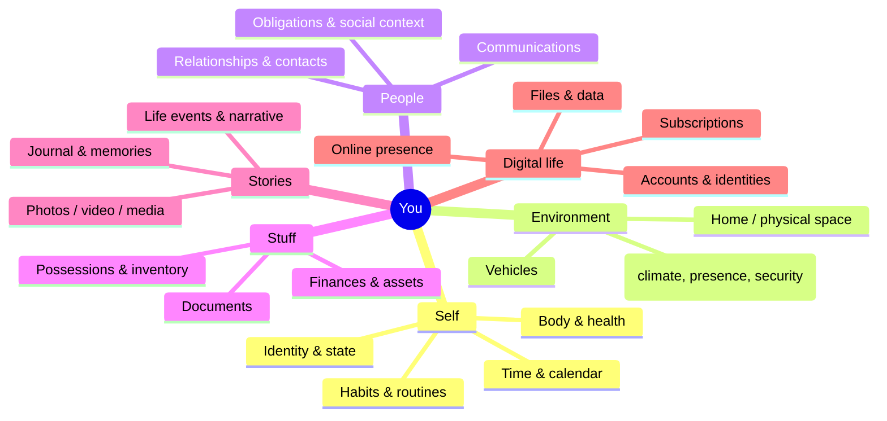

# Vaporware — Life Taxonomy (draft v0)

Six domains, each with a sensing (capture) side and an acting
(actuate) side. This is a shallow first pass across everything — depth
comes later, per domain.

## 1. Self
Body, health, identity, mental/emotional state, time, habits.
- **Capture:** wearables, health apps, mood/journal check-ins, calendar
  history, sleep/activity data.
- **Act:** schedule adjustments, reminders/nudges, habit coaching,
  health alerts, time-blocking.

## 2. Environment
The physical spaces you occupy — home, car, office.
- **Capture:** IoT sensors (temp, presence, air quality, security
  cameras), smart home state, location.
- **Act:** climate control, lighting, security automation, presence-
  aware scenes.

## 3. People
Everyone in your life and your relationship/communication with them.
- **Capture:** contacts, message/email history, social context,
  important dates, relationship notes.
- **Act:** reminders to reach out, drafting messages, surfacing
  context before a call/meeting, gift/date tracking.

## 4. Stuff
The physical things you own.
- **Capture:** inventory (what you own, where it is), receipts/
  warranties, home documents, financial accounts/assets.
- **Act:** maintenance reminders, reorder-before-you-run-out,
  insurance/warranty tracking, decluttering suggestions.

## 5. Stories
The narrative and memory of your life.
- **Capture:** journal entries, photos/video, voice notes, life events,
  milestones.
- **Act:** memory surfacing ("on this day"), auto-journaling from other
  domains' data, narrative summaries, media organization.

## 6. Digital life
Your presence and footprint in digital systems.
- **Capture:** accounts, files, subscriptions, digital identity,
  online activity.
- **Act:** subscription/account hygiene, file organization, digital
  declutter, security/privacy upkeep.

## Open questions (to discuss)

- Are "Stuff" and "Digital life" actually separate, or is digital life
  just another form of stuff? Leaning toward keeping separate since the
  actuation surface is very different (physical vs. accounts/data).
- Where do finances live — under Stuff, or their own domain? Drafted
  under Stuff for now, but money touches every domain.
- "People" capture is the most privacy-sensitive domain by far — may
  need its own governance rules distinct from the rest.
