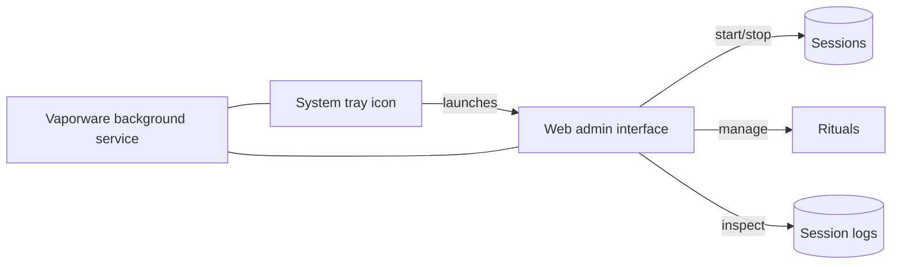

# Vaporware — Core Architecture (draft v0)

Two orthogonal structures:

- **`01-taxonomy.md`** = *what* the system orchestrates (the six life
  domains).
- **This doc** = *how* it's built — the shared layers every domain
  plugs into, and the physical nodes those layers run on.

## Shared orchestration layers

Every domain (self, environment, people, stuff, stories, digital life)
plugs into the same five layers rather than reinventing them:

```mermaid
flowchart TB
    subgraph Interfaces["Interfaces"]
        Chat[Chat / voice]
        Dash[Dashboard / ambient display]
        Notif[Notifications]
    end

    subgraph Reasoning["Reasoning & Orchestration"]
        LLM[Local LLM(s) / agents]
        Planner[Planner / router]
    end

    subgraph Memory["Memory & Context Store"]
        World[World model of you]
        Struct[Structured data]
        Unstruct[Unstructured: notes, media, logs]
    end

    subgraph Sensing["Sensing / Capture"]
        Adapters1[Adapters: APIs, IoT, files, manual input]
    end

    subgraph Actuation["Actuation"]
        Adapters2[Adapters: smart home, messages, calendar, tasks]
    end

    subgraph Governance["Governance"]
        Perms[Permissions / autonomy levels]
        Audit[Audit trail]
    end

    Sensing --> Memory
    Memory --> Reasoning
    Reasoning --> Actuation
    Reasoning --> Interfaces
    Interfaces --> Reasoning
    Governance -.constrains.-> Reasoning
    Governance -.constrains.-> Actuation
```

- **Sensing/Capture** — adapters that pull data in: APIs, IoT/sensor
  feeds, file watchers, manual/voice input. Two sub-layers, see
  `03-components.md`: the **Observer** family (VisualObserver,
  SoundObserver, EnvironmentObserver, ...) does perception — turning ambiguous
  raw signal into structured events; **Controls** (dials/knobs/sliders,
  routed via Spacebrew 2.0/MQTT) carry already-structured, explicit
  user input and need no inference step. Both converge on **MQTT** as
  the transport into Vaporware core, confirmed by SoundObserver's real
  implementation — Observers run as independent satellite projects
  (own process, own machine if needed) that publish events; the base
  just subscribes. No Observer is ever called directly over HTTP by
  the reasoning/memory layer.
- **Memory/Context** — the durable "world model" of you: structured
  facts, time-series, and unstructured material (notes, transcripts,
  photos), queryable by the reasoning layer. Organized around
  **Sessions** — see `06-sessions.md` — the base unit of experience
  that every stored event or derived state belongs to.
- **Reasoning/Orchestration** — local LLM(s) and agents that interpret
  state, plan, and decide what (if anything) to do.
- **Actuation** — adapters that take action: smart-home commands,
  sending messages, editing calendars, creating tasks, plus the
  broader **Actuator** family (Display, Audio, Light, Motion, Print,
  Fabrication) — see `04-actuators.md`, which also defines a
  Risk/Reversibility tier (R1–R3) feeding directly into this layer's
  Governance constraints below.
- **Interfaces** — two distinct kinds, worth not conflating:
  **interaction** (chat, voice, ambient displays/signals — the AI
  talking to you day to day) and **admin/control** (the web admin
  interface below — operating the system itself: sessions, Rituals,
  wiring). Sessions are started/stopped through the admin interface,
  not the interaction surface.
- **Governance** — cross-cutting: what it's allowed to do
  autonomously vs. suggest-only, and a record of what it did and why.

## Vaporware core service shape (decided)

The Vaporware core process is shaped like Spacebrew 2.0 itself
(`03-components.md`) — a background service with a system tray
presence, not a standalone app you open and close:

- **Background service** — runs continuously, hosting
  Reasoning/Memory/Governance for whichever base it's running on
  (typically Homebase).
- **System tray icon** — minimal always-available control: is the
  service running, quick status, launches the admin interface.
- **Web admin interface** — the actual control surface, served
  locally by the core service and opened in a browser (mirrors
  Spacebrew's own patch-bay dashboard). This is where you:
  - **Start and stop Sessions** (`06-sessions.md`) — decided: this is
    the only place session start/stop happens for now, not CLI, not
    voice.
  - Manage/inspect Rituals (`05-rituals.md`).
  - Review session logs and summaries.
  - Presumably view or link to Spacebrew's own patch-bay for Control
    wiring (open question below).



### Decisions (Core service, admin UI)

- **Relationship to Spacebrew's own dashboard — stays separate.**
  Spacebrew's patch-bay UI (raw Control/MQTT wiring) and Vaporware's
  admin interface (sessions/Rituals/logs) are two distinct local web
  UIs, not merged into one.
- **Access/auth — localhost-only by default.** The admin interface is
  not exposed remotely. Travelbase does **not** reach Homebase's admin
  interface through the Relay base while away; instead it queues
  locally and **resyncs opportunistically once it's physically back on
  the same LAN as Homebase.** This simplifies the Relay base's job
  considerably (see the note in "Deployment topology" below) and keeps
  the admin surface's attack surface minimal — nothing to expose to
  the internet at all.

- **Multi-base admin — decided.** Travelbase runs its **own copy of
  the admin interface**, localhost-only just like Homebase's — but
  scoped only to what Travelbase itself holds (its cached memory
  subset, its own active Sessions/Rituals). It has no access to
  Homebase's authoritative data store; it's a view over Travelbase's
  own state, not a remote window into Homebase. This stays consistent
  with Homebase being sole source of truth — Travelbase's admin UI can
  manage what's local to it, not reach further.

## Deployment topology: four bases

**Decided:** everything runs locally — no third-party cloud in the
critical path, ever, not even as a fallback. **Homebase is the sole
source of truth**; every other base is a cache, a sensor, or plumbing,
never an alternate authority.

The layers above don't all run in one place — they run across
physical nodes with very different compute, power, and connectivity
budgets. Four bases, each a different mix of the same five layers:

```mermaid
flowchart LR
    subgraph Home["Homebase (source of truth)"]
        H1[Full local LLM stack]
        H2[Primary memory store — authoritative]
        H3[Home automation hub]
        H4[Highest compute, mains power, wired/LAN]
    end

    subgraph Travel["Travelbase"]
        T1[Laptop / portable hub]
        T2[Cached subset of memory]
        T3[Lighter/quantized local model — no cloud fallback]
        T4[Offline-tolerant, syncs when reachable]
    end

    subgraph Wearable["Wearable base"]
        W1[Phone / watch / ear-worn]
        W2[Always-on sensing: biometrics, location, voice]
        W3[Thin client — little/no local reasoning]
        W4[Lowest power, tightest latency for capture]
    end

    subgraph Relay["Relay base (self-hosted)"]
        R1[Stateless encrypted tunnel / rendezvous]
        R2[No storage, no reasoning — pure plumbing]
        R3[Box or VPS you own, reachable from anywhere]
    end

    Wearable -- capture stream, whichever is reachable --> Travel
    Wearable -- capture stream, whichever is reachable --> Home
    Wearable -. neither reachable .-> Relay
    Travel <--sync + admin access, on home LAN only--> Home
    Relay -- forwards to --> Home
```



| | **Homebase** | **Travelbase** | **Wearable base** | **Relay base** |
|---|---|---|---|---|
| Role | Sole source of truth, heaviest reasoning | Mobile continuity | Always-on sensing/thin actuation | Connectivity only |
| Compute | Highest (server/mini-PC/NAS) | Medium (laptop or portable hub) | Minimal (phone/watch class) | Minimal (just a tunnel endpoint) |
| Storage | Authoritative memory store | Cached subset, queued writes | None (streams out immediately) | None — stateless by design |
| Power/connectivity | Mains, wired/LAN | Battery, intermittent | Battery, always-on but constrained | Always-on, public reachability |
| Domains it's strongest at | Environment, Stuff, Digital life | Self, People (on the go) | Self (biometrics), real-time capture | N/A — infrastructure, not a domain node |
| Autonomy posture | Can hold higher-trust automations (home is a controlled environment) | Conservative — writes queue until synced to Homebase | Capture-only by default; rarely acts on its own | None — never reasons or decides |
| Failure mode | Single point of truth — its downtime is the system's downtime | Degrades to local-only cache, queues sync | Must never block on connectivity | Its downtime just removes remote reach, nothing is lost |

### Why a relay base instead of cloud fallback

Without home-network access, some base still needs a way to reach
Homebase from anywhere. Rather than reaching for a third-party cloud
API (which would break the local-only tenet), the relay is
infrastructure you own — e.g. a small VPS or a box at a second
location — that does nothing but forward encrypted traffic between a
remote base and Homebase. It never stores data at rest and never runs
inference; if it's compromised, there's nothing on it to steal, and
the connection it carries should be end-to-end encrypted regardless.

**Narrowed scope (decided):** Travelbase does **not** use the Relay
for routine sync or admin access — the admin interface is
localhost-only (`## Vaporware core service shape` above), and
Travelbase's normal sync model is "queue locally, resync in bulk once
back on Homebase's LAN." This is simpler than a live tunnel and needs
nothing exposed to the internet for the common case.

**Wearable sync (decided):** Wearable base syncs opportunistically to
**whichever of Travelbase or Homebase it can reach directly** — not
routed exclusively through Travelbase. On a trip, that's Travelbase;
at home, that's Homebase directly; either way it's a direct local
connection (Bluetooth/LAN), no Relay involved. The Relay is only the
fallback for the remaining gap: Wearable reachable by **neither**
Travelbase nor Homebase (e.g. left behind, or out of range of both).

### Open questions (to discuss)

- **Relay implementation** — self-hosted VPN/tunnel (e.g. WireGuard-
  style point-to-point) vs. a rented VPS as rendezvous vs. a device at
  a trusted second location (family member's house)? Any of these keep
  the "self-hosted, stateless" property; the choice is about
  convenience and cost.
- **Wearable reasoning** — does the wearable base ever run any model
  locally (e.g., wake-word, simple triage) or is it purely a sensor +
  relay to Travelbase/Homebase? Affects battery life and latency a lot.
- **Travelbase identity** — is this a dedicated device, or just "your
  laptop with the stack installed"? Simpler to start as the latter.
- **Offline behavior per domain** — when Travelbase/Wearable can't
  reach Homebase or the relay, what degrades gracefully vs. queues vs.
  refuses to act? Needs an answer per domain, not one global rule.
- Does each base need its own security/permission boundary (e.g.
  wearable capture is more sensitive to leak than a home-sensor log)?

## Status

Draft v0, written 2026-07-03. Mermaid diagrams are sketches to argue
with, not final. Next: pick a first domain (or the shared memory
layer) to design in depth, per `01-taxonomy.md`.
