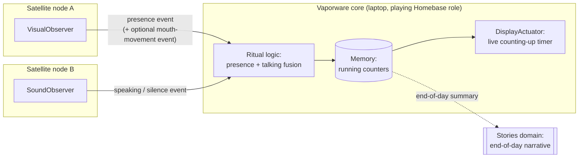
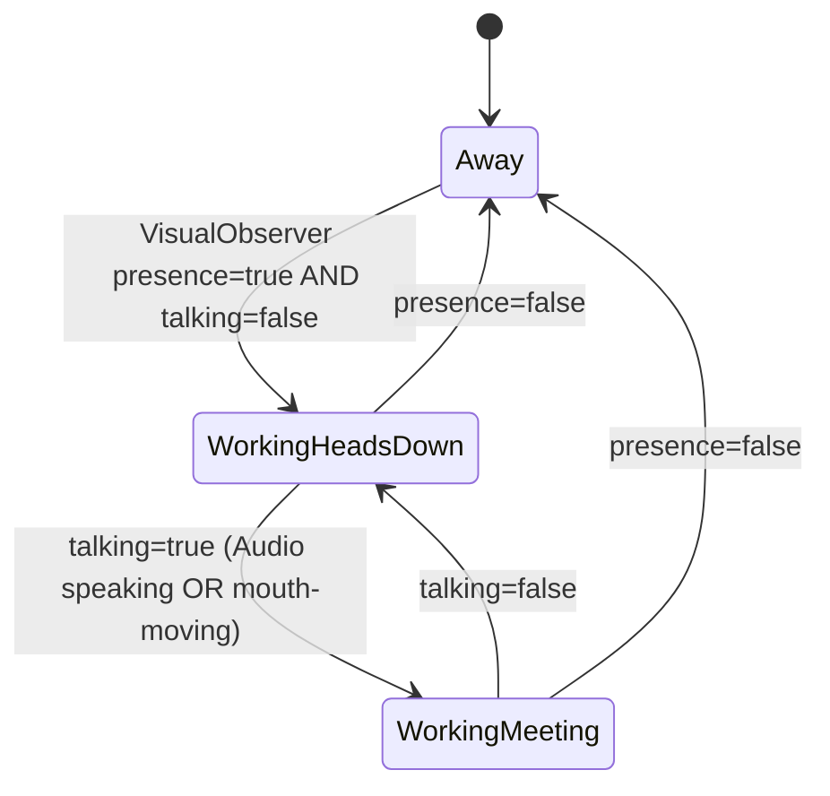

# Vaporware — Rituals: wiring components together (draft v0)

A **Ritual** is a persistent, named unit of orchestration, created from
a natural-language prompt, that:

1. **Subscribes** to one or more Observer/Control event streams.
2. **Applies logic** (fusion, derivation, thresholds, state machines)
   in the Reasoning layer.
3. **Persists state** (counters, transitions, running totals) in
   Memory.
4. **Renders output** through one or more Actuators.
5. Optionally **writes back** a summary into a domain (often Stories,
   as narrative — but Ritual-the-mechanism and Stories-the-domain are
   deliberately different concepts; see `01-taxonomy.md`).

This doc works one concrete Ritual end-to-end to pressure-test the
whole component model built in `01`–`04`.

## Worked example: "help me track how much I'm working and how much of that is meetings/talking"

### Hardware layout (refines `03-components.md`)

Observers don't have to run on a Base at all — they can run on their
own **dedicated satellite nodes**, forwarding structured events to
whichever machine is running Reasoning/Memory. In your example:

- A **VisualObserver** runs on its own computer (camera attached).
- A **SoundObserver** runs on a *different* computer (mic attached).
- **Vaporware's core** (Reasoning + Memory) runs on a laptop — for
  this example that laptop is playing the **Homebase role**, even
  though the four-base doc (`02-architecture.md`) pictured Homebase as
  dedicated server-class hardware. Worth an explicit call-out: early
  on, one laptop can *be* Homebase; dedicated hardware is an upgrade,
  not a prerequisite.

### The fusion logic: two Observers, one derived fact

You proposed detecting "talking" two ways: SoundObserver (is there
speech) and VisualObserver watching the mouth (is it moving). Both feed
the same derived state rather than one replacing the other:

- **Away** — VisualObserver: no presence.
- **WorkingHeadsDown** — presence, not talking. Counts as "working."
- **WorkingMeeting** — presence + talking (from either signal). Counts
  as both "working" *and* "in a meeting/talking with someone."

Each state transition is a timestamped event in Memory; the running
counters (total working time, total meeting/talking time) are a
*derived, continuously-updated view* over those transitions — not a
one-off event, which is a new pattern relative to Observers emitting
discrete events (see open question below).

### Ritual definition (schema, applied to this example)

| Field | This Ritual |
|---|---|
| **Trigger prompt** | "Help me track how much I am working and how much of that time I am in video call meetings or talking with people at my desk" |
| **Inputs** | VisualObserver (presence, optionally mouth-movement), SoundObserver (speaking/silence) |
| **Logic** | State machine above; talking = OR of two signals |
| **State (Memory)** | Transition log (timestamped) + derived running counters, scoped to the current Session (see `06-sessions.md`); cross-session rollups (today/historically) are a separate aggregation over multiple sessions' logs |
| **Outputs** | DisplayActuator — live counting-up timer(s) |
| **Domain(s) fed** | Self (work/focus tracking); optionally Stories (a daily narrative line: "You worked 6h20m today, 2h10m in meetings") |
| **Risk tier** | R1 — pure observation + a display counter, no consequential action. Fully autonomous by default; nothing here needs a confirmation gate. |

This is a good template for a "safe first Ritual" precisely *because*
it's R1 end-to-end — a useful contrast case for when a Ritual later
needs to send a message or trigger a MotionActuator (R3) and suddenly
needs Governance sign-off.

## Open questions (to discuss)

- **Signal disagreement / confidence** — what happens when the two
  "talking" signals disagree? (TV audio with no one present; a phone
  call through earbuds where the mic doesn't catch your voice but
  SoundObserver hears nothing while your mouth moves.) Does the Ritual
  need a confidence-weighted fusion instead of a plain OR, or is OR
  fine for v0 and we tighten it later based on false positives?
- **Ritual authoring model** — once created from a prompt, is a Ritual
  *compiled* into a fixed pipeline (stable subscriptions + logic,
  cheap to run continuously), with Reasoning only re-invoked for
  ambiguous cases? Or does every event re-run through the LLM? The
  former is far cheaper for something that runs all day; worth
  deciding before building the first one.
- ~~Derived/continuous state as a Memory concept~~ **Resolved by
  `06-sessions.md`:** a running counter is a read over the current
  Session's log, not a separate storage concept. Cross-session rollups
  (e.g. today's total across several start/stop sessions) remain their
  own open question there.
- ~~Satellite node identity~~ **Partially resolved, real
  implementation:** for the MQTT side that Vaporware core actually
  subscribes to, SoundObserver doesn't register with Vaporware core at
  all — it's a plain MQTT publisher on a fixed, documented topic
  (`soundobserver/speech/transcribed`), and Vaporware core subscribes
  to that topic on startup regardless of whether a session is
  active (`app/mqtt_bridge.py`). Simpler than Spacebrew's dynamic
  patch-bay rewiring for Controls — fine for one Observer with one
  topic, but worth revisiting if/when there are enough Observers that
  hardcoded topic names stop scaling and dynamic discovery/rewiring
  actually earns its complexity. Note SoundObserver *does* now also
  register as a real Spacebrew client for its `tts`/`word`/`segments`/
  `sound_detected` topics (`03-components.md`) — the "doesn't register"
  claim only ever held for the MQTT-to-Vaporware-core path.
- **Naming check** — "Ritual" is a working name (chosen to avoid
  colliding with "Habits & routines" under Self in `01-taxonomy.md`).
  Flag if it doesn't stick.

## Status

Draft v0, written 2026-07-03. First worked example of the full
pipeline: `03-components.md` (Observers) → this doc's fusion logic
(Reasoning) → Memory → `04-actuators.md` (DisplayActuator) → optional
write-back into `01-taxonomy.md`'s Stories domain.
