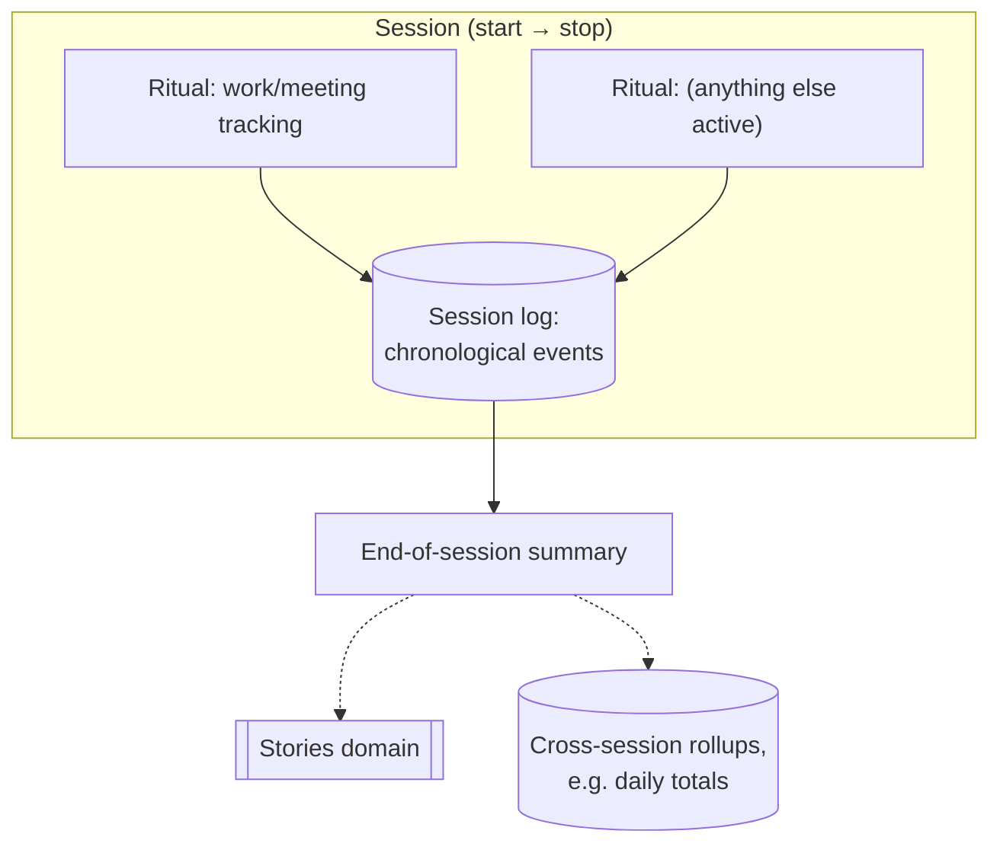
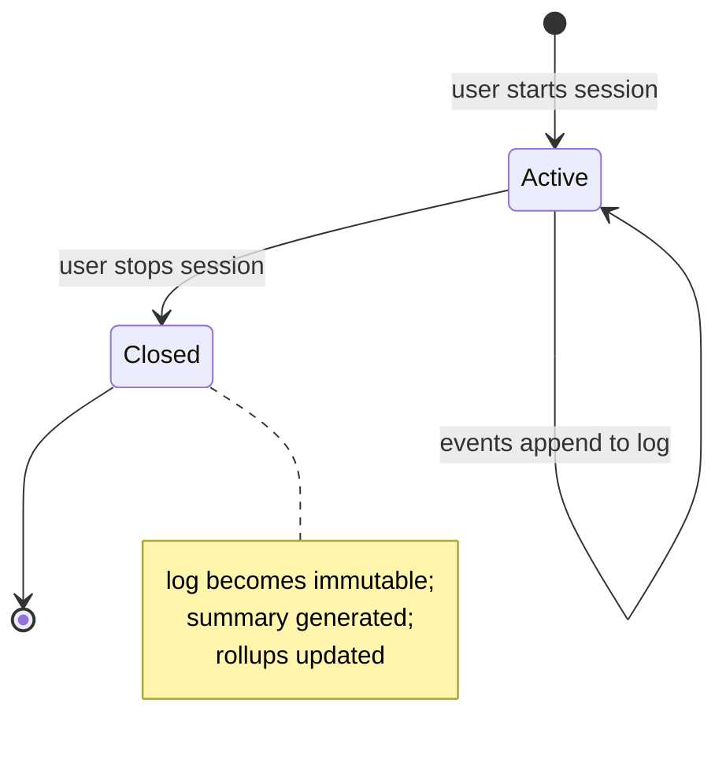

# Vaporware — Sessions: the base unit of experience (draft v0)

## Definition

A **Session** is a bounded period during which Vaporware is actively
watching, reasoning, and (potentially) acting — the base unit the
whole system's experience is organized around. Everything that
happens during a session (Observer events, Control input, Ritual
state, Actuator output) is appended to that session's **log**.

- **v0:** manually started and stopped by the user.
- **Later:** may extend toward continuous/all-day sessions, or
  automatic start/stop (e.g. triggered by presence). The schema below
  is designed so that's a natural extension, not a rewrite — a
  perpetual session is just the degenerate case of "very long,
  auto-started."

**Decided:** a Session is a **general container, not tied to a single
Ritual.** Zero, one, or several Rituals can be active inside one
session. Starting the "track my work" Ritual doesn't define the
session's boundary — it's one thing that happens to be running during
whatever session is currently open.

## Relationship to Rituals

- A **Ritual** (`05-rituals.md`) is a reusable *definition*: which
  Observers/Controls it watches, what logic it applies, what it
  outputs.
- A **Session** is the *runtime container* that Rituals attach to.
  The same Ritual can be active across many different sessions over
  time (rollups can aggregate across them); a single session can have
  multiple Rituals running concurrently (e.g. work-tracking + a
  posture-check Ritual, both active in the same session).

## Session lifecycle

## Session log — draft schema

| Field | Description |
|---|---|
| `session_id` | Unique identifier |
| `started_at` | Timestamp, set on start |
| `stopped_at` | Timestamp, null while active |
| `active_rituals` | Which Ritual(s) were attached, and when each joined/left the session (a Ritual could start mid-session or stop before the session ends) |
| `log` | Chronological, append-only stream: raw Observer/Control events, derived state transitions (e.g. the WorkingHeadsDown → WorkingMeeting change from `05-rituals.md`), Actuator outputs |
| `summary` | Generated once the session closes — human-readable + structured (e.g. "worked 6h20m, 2h10m in meetings") |

Applying this to the `05-rituals.md` example: starting a session,
attaching the work-tracking Ritual, working for a few hours, then
stopping the session produces exactly one closed session log with one
Ritual's full transition history in it — the running counters shown
live on the DisplayActuator are just a read of "time in each state,
this session, so far."

## Cross-references / updates to prior docs

- **`02-architecture.md` (Memory layer)** — Session is now the
  organizing unit for Memory: every stored event/derived-state row
  belongs to a session, resolving the earlier open question of how
  "continuous derived state" (like a live counter) should be modeled
  — it's a read over the current session's log, not a separate
  storage concept.
- **`05-rituals.md`** — a Ritual's "State (Memory)" field is
  session-scoped by default; historical totals (e.g. "today's total
  work time" across multiple start/stop sessions) are a **rollup**
  across sessions, not part of any one session's log.

## Open questions (to discuss)

- ~~Start/stop trigger~~ **Decided:** the Vaporware core service is
  shaped like Spacebrew 2.0 itself — a background service with a
  system tray icon that launches a **web admin interface**
  (`02-architecture.md`). Sessions are started/stopped from that admin
  interface specifically, not CLI or voice. A physical Control
  (button/dial via Spacebrew) as an *additional* start/stop trigger
  later is still plausible, but the admin interface is the v0 answer.
- **Concurrent sessions** — can two sessions be open at once (e.g. a
  broad "today" session and a nested "focus" session), or is v0 a
  single active session at a time? Simplest default: one at a time for
  now.
- **Cross-session rollups** — daily/weekly totals spanning multiple
  sessions need their own aggregation logic distinct from any single
  session's log. Worth designing once there's more than one Ritual
  that needs a rollup, rather than now.
- **Path to all-day/continuous sessions** — when this evolves, does a
  "day" become one long session with internal segments, or do we keep
  many short sessions but auto-start/stop them (e.g. on presence)? The
  schema above doesn't force an answer yet, but the auto-start trigger
  will need to live somewhere (probably a Ritual of its own, watching
  VisualObserver presence).

## Status

Draft v0, written 2026-07-03. Session is now the organizing unit
referenced by `02-architecture.md` (Memory) and `05-rituals.md`
(Ritual state).
