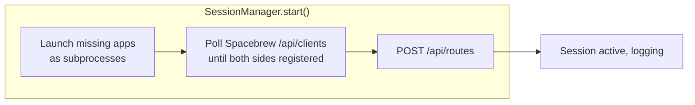

# Vaporware — Test Experiences: Magic Word & Presence Light (draft v0)

Two small end-to-end experiences meant to pressure-test the whole
pipeline for the first time: Observer → Ritual (Reasoning) →
**Spacebrew** → a Processing app standing in for an Actuator. Between
them they touch both Observer modalities that actually work today
(audio, vision), and force a decision this project hasn't made yet:
**what does "starting a session" do when a test experience needs
external apps launched and Spacebrew routes wired, not just an
already-running MQTT stream logged?**

## New shared capability: session start as launcher + auto-wirer

Two decisions, made explicitly for these two experiences (not
necessarily the permanent answer — see Open questions):

- **Real Spacebrew client, not a side-channel topic.** The Ritual
  logic in vaporware-core registers itself as a genuine Spacebrew
  client (own name, declared publisher) and the patch-bay/router
  handles delivery to the Processing app, rather than publishing on a
  private fixed MQTT topic that bypasses Spacebrew entirely. This
  means Spacebrew's registration protocol and REST API become a real
  dependency of vaporware-core, not just infrastructure Controls
  happen to use (`03-components.md`).
- **Single machine only, for now.** Session start assumes
  SoundObserver, VisualObserver, the Spacebrew router, and the Processing
  app all run on the same box as vaporware-core — not the full
  satellite-node deployment topology from `02-architecture.md`.
  Multi-machine orchestration is a real gap, deliberately deferred.

Concretely, starting a session for one of these experiences now needs
to:

1. Launch (as subprocesses) whichever of {SoundObserver, VisualObserver,
   Spacebrew router, the relevant Processing app} aren't already
   running — tracking which ones vaporware-core itself started, so
   stop only tears those down, not a pre-existing manual setup.
2. Poll Spacebrew's `GET /api/clients` until both the Ritual's client
   and the Processing app's client have registered.
3. Call `POST /api/routes` with `{pub: "<RitualClient>/<pubName>", sub:
   "<ProcessingClient>/<subName>"}` — this replaces manually dragging a
   connection in the patch-bay UI for these two demo pipelines.
4. Proceed with the session as normal (log events to `session.log`).
5. On stop: tear down only the processes this session launched.

This is new scope beyond what `06-sessions.md` describes today (which
only optionally subscribes to an already-running SoundObserver) —
worth folding back into that doc once proven out here, not before.

## Experience 1: "Magic Word"

| Field | Value |
|---|---|
| **Trigger prompt** | "Listen for someone saying 'play' or 'drumroll' and count how many times each is said" |
| **Observer** | SoundObserver, Mode 1 (Anonymized Realtime) — full transcript now runs here (no speaker identity attached), and it's the only mode with working recognition today; Modes 2/3 (speaker diarization/identification) remain stubs and aren't needed for this experience anyway. Topic: `soundobserver/speech/transcribed`, payload `{text, duration, mode}`. If both VoiceBox STT and Apple Native STT are enabled at once, expect one transcript event per engine per utterance (tagged `source`) — the Ritual logic below would double-count matches unless it de-dupes or the experience runs with only one STT engine on. |
| **Ritual logic** | On each transcript, lowercase + tokenize `text`, check for `"play"` or `"drumroll"`. On a match, publish just the matched word (not the whole transcript — content minimization, given T3 sensitivity) via its own Spacebrew publisher `MagicWordRitual/word`. |
| **Spacebrew wiring** | Ritual registers as client `MagicWordRitual`, `pubs: word:string`. Processing app registers as `MagicWordCounter`, `subs: word:string`. Session start creates the route `MagicWordRitual/word -> MagicWordCounter/word`. |
| **Processing app** | New sketch (parallel to Spacebrew2.0's `Examples/Processing/processing_client.pde`): subscribes to `word`, maintains two integer counters (`playCount`, `drumrollCount`), increments whichever matches on each received message, renders both counters full-screen. |
| **State (Memory)** | Same pattern as `05-rituals.md`'s counters — running totals are a read over the current session's log of `magic_word_detected` events, not separately stored. The Processing app's on-screen counters are a display-local mirror, reset when the sketch restarts (session start relaunches it fresh) — flagged below as an open question. |
| **Domain(s) fed** | Self/Stories, loosely — this experience is mostly a plumbing test, not meant to carry real domain meaning. |
| **Risk tier** | R1 — pure observation + a display counter, same shape as the work-tracking Ritual in `05-rituals.md`. No Governance gate needed. |

### Privacy note

This runs SoundObserver's default mode (Mode 1) for the express purpose
of spotting two words — worth flagging that Mode 1 records the *entire*
conversation as T3 content, not just "play"/"drumroll," because full
transcription is the only recognition path implemented today and it's
gated by identity (none attached), not by content (nothing filters the
transcript down to just the magic words before it leaves SoundObserver
— that minimization happens downstream, in the Ritual). This is a
sharper version of the same caution that applied under the old
Mode-3-only framing, not a weaker one: Mode 1 being "least identifying"
doesn't mean "least sensitive," and it's also SoundObserver's *default*
mode now, so this level of capture starts the instant a session begins
— no explicit mode escalation required, unlike what this doc originally
assumed. Fine among consenting participants for a test; not something
to leave running silently.

## Experience 2: "Presence Light"

| Field | Value |
|---|---|
| **Trigger prompt** | "Show me when someone's in the room by changing a light" |
| **Observer** | VisualObserver, Mode 1 (Anonymized Realtime — detection/tracking/MQTT publish). Unlike SoundObserver, VisualObserver's Mode 2 (StrongSORT re-ID) is also marked Working, not a stub — only Mode 3 (DeepFace identity/attributes, Ollama/LLaVA description) is stub-only. This experience only needs Mode 1 regardless. Topics: `visualobserver/person/entered`, `visualobserver/person/exited`, payload `{id, centroid, bbox, mode}` (the real payload also carries the active `mode` number, not just `id`/`centroid`/`bbox`). |
| **Ritual logic** | Maintain an occupancy count: increment on `person/entered`, decrement on `person/exited`; derive `occupied: bool` = count > 0. On each transition, publish via Spacebrew publisher `PresenceLightRitual/occupied` (`"true"`/`"false"`). |
| **Spacebrew wiring** | Ritual registers as `PresenceLightRitual`, `pubs: occupied:boolean`. Processing app registers as `PresenceLight`, `subs: occupied:boolean`. Session start wires `PresenceLightRitual/occupied -> PresenceLight/occupied`. |
| **Processing app** | New sketch: full-window color fill — warm color when occupied, dim/dark when empty. A stand-in `LightActuator` (`04-actuators.md`), since no real smart-light integration is built yet; a Hue bulb would play the same role later. |
| **State (Memory)** | Occupancy transitions logged as session events — structurally the same shape as the `WorkingHeadsDown`/`WorkingMeeting` state machine in `05-rituals.md`, but with one Observer instead of two. |
| **Domain(s) fed** | Environment (occupancy). |
| **Risk tier** | R1 — observation + a color-changing display, no consequential action. |

### Why this one, paired with Magic Word

Presence Light deliberately reuses the *other* working Observer and
the simplest possible Ritual logic (no fusion, nothing T3-sensitive),
so the only new thing it stresses relative to Magic Word is having a
**second, concurrent** Ritual + Spacebrew client pair alive in the same
session — a real test of whether "auto-wire on session start" holds up
with more than one pipeline active, and whether SessionManager can
launch/track two independent Processing apps cleanly.

## What this doesn't test yet (explicitly out of scope)

- Multi-machine/satellite-node launch — both experiences assume one box.
- Any R2/R3 Actuator (printing, motion, messaging) — both stay at R1
  on purpose, as a "does the plumbing work at all" test before adding
  Governance gating.
- SoundObserver Modes 2/3 (speaker diarization/identification) — Magic
  Word doesn't need to know *who* said "play," only that someone did,
  so these stay stubs for this experience. (Correction from an earlier
  draft of this doc: there's no separate "keyword-only, no full
  transcript" mode to fall back to instead — Mode 1 *is* full
  transcription now; see the Privacy note above.)
- Spacebrew route teardown on session stop — `routes.txt` is currently
  append-only/persisted; whether a session should delete the routes it
  created isn't decided (leaving them in place is probably harmless,
  since a route is inert once the clients that own it disconnect).

## Open questions (to discuss)

- **"Already running" vs. "session-started."** If SoundObserver was
  already open from a previous session, does starting Magic Word again
  reuse it (correct, given Observers run independent of sessions per
  `05-rituals.md`) or try to relaunch a duplicate? Needs a real
  running-process check, not just "try to launch and see if it errors."
- **Where do the Processing sketches live?** New sibling projects next
  to SoundObserver/VisualObserver/Spacebrew2.0 (e.g.
  `../MagicWordCounter`, `../PresenceLight`), matching the existing
  satellite-project pattern, or inside `vaporware-core` since they're
  test-only? Leaning sibling; flag if that's wrong.
- **Headless Processing launch.** `processing-java --sketch=<dir>
  --run` needs the Processing IDE's command-line tool installed and on
  `PATH` — worth confirming that's available before scripting the
  subprocess launch.
- **Counter/state persistence.** Should a Processing app's on-screen
  count rehydrate from the session log on (re)launch, or is starting
  at zero each session correct?

## Status

Draft v0, written 2026-07-03, updated 2026-07-11 for the AudioObserver
→ SoundObserver rename (Magic Word's Observer row and privacy note
corrected — full transcription runs in Mode 1, not Mode 3, under the
new implementation). Depends on: `03-components.md`
(SoundObserver/VisualObserver, both real projects), `05-rituals.md`
(Ritual schema), `06-sessions.md` (Session as container — extended
here with launch/wire responsibilities not yet folded back into that
doc), and Spacebrew 2.0's `web_service.py` REST API (`/api/routes`,
`/api/clients`) plus its Processing client example
(`Examples/Processing/processing_client.pde`). Nothing here is built
yet — this is the plan for what to build next.
